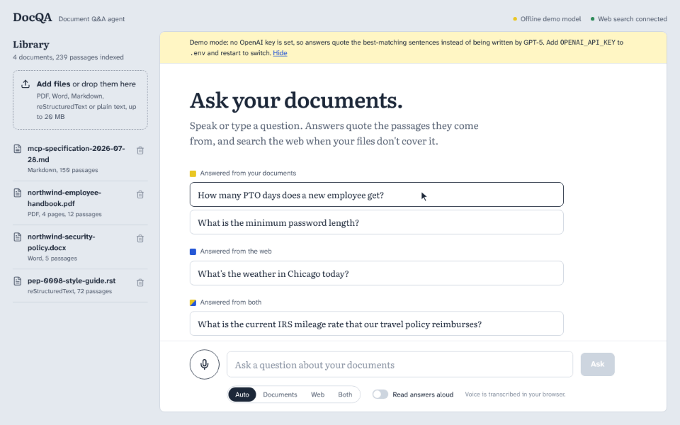
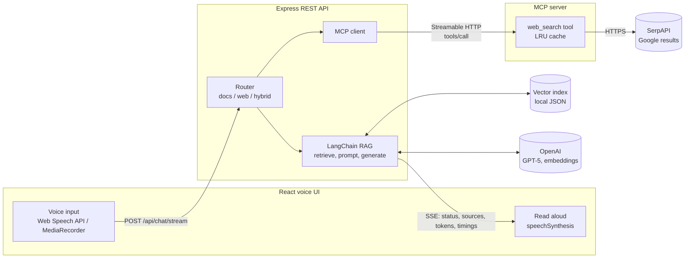

# DocQA: a voice-enabled document Q&A agent

Ask questions about your documents by voice or text. A LangChain RAG pipeline on **GPT-5** answers from your files
and calls **SerpAPI web search through an MCP server** when the question needs fresher or outside information.
Every answer cites its sources and is streamed token by token, so it starts appearing (and can be read aloud)
almost immediately.

**Stack:** React 19 + Vite (voice UI) · Node.js + Express 5 (REST API, SSE) · LangChain.js (RAG) · OpenAI GPT-5 and
`text-embedding-3-small` · Model Context Protocol TypeScript SDK v2 (spec 2026-07-28) · SerpAPI · TypeScript everywhere



<sub>Recorded with `npm run demo` (see [Recording the demo](#recording-the-demo)). This recording uses the offline
demo mode (no API keys): answers quote the best-matching sentences and web results are mock.</sub>

## Features

- **Document Q&A with citations.** Upload PDF, Word, Markdown, reStructuredText or text files. Answers cite the exact
  passage (`[D1]`, with file, page and section) or web result (`[W1]`) they rely on; click a citation to open it.
- **Agentic routing between documents and the web.** For each question the agent decides whether to answer from the
  documents, the web, or both, based on retrieval scores and what the question asks for (for example "current",
  "latest", "national average"). Users can also force a source.
- **Web search as an MCP tool.** A standalone MCP server exposes a `web_search` tool backed by SerpAPI (Google). The
  API calls it over Streamable HTTP; Claude Desktop or any other MCP host can use the same server over stdio.
- **Voice in and out.** Speech-to-text with the browser's Web Speech API, or server-side transcription
  (`gpt-4o-mini-transcribe`) where the browser has none. Answers can be read aloud sentence by sentence while they
  are still streaming, and speaking again interrupts the reading.
- **Built for low latency.** Retrieval and web search run in parallel, routing needs no extra LLM call, GPT-5 runs
  with minimal reasoning, caches skip repeated work, and the UI shows a timeline of where the time went.
- **Runs without keys.** Missing keys switch to an offline demo model and mock search results, so the whole app,
  the tests and CI work out of the box.

## Architecture



How one question flows through the system:

1. The browser transcribes speech (or takes typed text) and sends `POST /api/chat/stream`.
2. The API starts two things **in parallel**: embedding the question plus a vector search over the document chunks,
   and, if the question looks like it needs fresh or outside facts, an MCP `tools/call` to `web_search`.
3. The router picks a route from the best retrieval score and the question's intent: `docs`, `web` or `hybrid`.
4. Retrieved chunks and web results become a numbered context (`[D1]`, `[W1]`, …) and GPT-5 streams an answer that
   must cite them.
5. The client receives Server-Sent Events: `status` → `meta` (route and sources) → `token`s → `done` (timings and
   token usage), renders citations as it goes and, if enabled, speaks each finished sentence.

## Quick start

Requirements: Node.js 22.12 or newer. API keys are optional: an
[OpenAI key](https://platform.openai.com/api-keys) for GPT-5 and a [SerpAPI key](https://serpapi.com/manage-api-key)
for live Google results.

```bash
npm install
cp .env.example .env     # add OPENAI_API_KEY and SERPAPI_API_KEY, or leave them empty for the demo mode
npm run dev              # MCP server :8787, API :3000, UI :5173
```

Open <http://localhost:5173>, click **Load sample documents** and try:

| Question | Expected route |
|---|---|
| How many PTO days does a new employee get? | documents |
| What is the minimum password length? | documents |
| What's the weather in Chicago today? | web |
| What is the current IRS mileage rate that our travel policy reimburses? | documents + web |

Other commands:

```bash
npm test                     # all tests, no keys or network needed
npm run typecheck
npm run ingest -- ~/docs     # index a folder from the command line (run while the API is stopped)
npm run bench                # latency + quality benchmark against the running API
npm run demo                 # record docs/demo.gif from the running app
npm run build && npm start   # production: the API serves the built UI on http://localhost:3000
docker compose up --build    # same, in containers
```

## Project structure

```
apps/
  web/          React voice UI (Vite)
  server/       Express REST API + LangChain RAG pipeline + MCP client
  mcp-search/   MCP server with the SerpAPI web_search tool
data/
  samples/      sample documents (PDF, DOCX, Markdown, reStructuredText) and their sources
  eval/         evaluation questions with expected routes, sources and facts
scripts/        record-demo.mjs (npm run demo), prepare_samples.py (rebuilds the sample documents)
benchmarks/     how to run the benchmark; reports go to benchmarks/results/
```

Where to find each part:

| Part | Code |
|---|---|
| Parsing PDF (per page), DOCX, Markdown, RST, text; header/footer removal | `apps/server/src/rag/loaders.ts` |
| Section-aware chunking, contextual chunk headers, ingestion | `apps/server/src/rag/knowledgeBase.ts` |
| Vector store (LangChain `VectorStore`, exact cosine search, persisted) | `apps/server/src/rag/vectorStore.ts` |
| Prompt and context formatting with citation tags | `apps/server/src/rag/prompts.ts` |
| Router (docs / web / hybrid) and follow-up query expansion | `apps/server/src/agent/router.ts` |
| Pipeline: parallel retrieval + web search, streaming generation, timings | `apps/server/src/agent/pipeline.ts` |
| GPT-5 and embedding models; offline stand-ins | `apps/server/src/llm/` |
| MCP client (persistent connection, timeout, reconnect) | `apps/server/src/mcp/webSearchClient.ts` |
| REST endpoints, SSE, upload limits, errors | `apps/server/src/app.ts`, `apps/server/src/routes/` |
| MCP server, `web_search` tool, Streamable HTTP and stdio transports | `apps/mcp-search/src/` |
| SerpAPI client, result normalization, cache with request coalescing | `apps/mcp-search/src/search/` |
| Voice input, read-aloud, SSE client | `apps/web/src/hooks/`, `apps/web/src/lib/` |

## How it works

### Ingestion

Each file is parsed into LangChain `Document`s. PDFs keep one document per page so answers can cite page numbers, and
lines that repeat on most pages (running headers, footers, page numbers) are dropped. The text is cut at section
headings first and then into 1,000-character chunks with 150 characters of overlap, so a chunk never mixes two
sections and carries an exact section label. Each chunk is embedded together with its file name and section title
("contextual chunk headers"), which helps short chunks match the question. Re-uploading identical content is
detected by SHA-256 and skipped.

### Retrieval and routing

The question is embedded (cached in an LRU) and matched against all chunks by cosine similarity. The router then
decides:

| Situation | Route |
|---|---|
| Best chunk scores above `RAG_MIN_SCORE` and the question needs nothing external | `docs` |
| Relevant chunks, and the question asks for current facts or compares with the outside world | `hybrid` |
| No chunk is relevant, or there are no documents | `web` |
| The user picked Documents / Web / Both | that route |
| Web search is disabled or the MCP server is down | `docs` |

Short follow-ups such as "and after six years?" are expanded with the previous question before retrieval, without an
extra model call.

### Web search through MCP

`apps/mcp-search` is an MCP server built with the MCP TypeScript SDK v2. Its `web_search` tool takes a query, result
count, optional time range and location, calls SerpAPI's Google engine and returns normalized results (title, URL,
snippet, date) plus a direct answer when Google shows one (answer box, knowledge graph, weather or stock card). The
tool declares input and output schemas and is annotated read-only. Results are cached for 10 minutes, and identical
queries that arrive together share one upstream request.

The API keeps one MCP client connected over Streamable HTTP, calls the tool with a timeout (`WEB_SEARCH_TIMEOUT_MS`)
and falls back to the documents if the search fails. Because search lives behind MCP, the provider can be swapped
(Bing, Brave, an internal search service) without touching the API, and other MCP hosts can reuse the tool.

### Generation

The prompt asks GPT-5 to use only the numbered context, cite every fact, say when it cannot find an answer, and keep
answers short enough to be read aloud. The model runs with `reasoning_effort: minimal`, `verbosity: low` and a token
cap; these values are configurable in `.env`. Tokens are streamed to the browser as Server-Sent Events, and a client
that disconnects cancels the OpenAI request.

### Voice

Chrome, Edge and Safari transcribe speech in the browser with the Web Speech API and show the words live as you
speak; recognition stops by itself when you pause, and the question is sent. Other browsers record a clip with
`MediaRecorder` (stopping after 1.5 s of silence) and send it to `POST /api/voice/transcribe`; add `?voice=server` to
the URL to use server transcription in any browser. Answers are read aloud
with `speechSynthesis` one sentence at a time while the rest of the answer is still streaming, with citations and
markdown removed.

## Latency

The goal is answers that start in well under two seconds, including questions that need both the documents and the
web. What the pipeline does for that:

| Technique | Where |
|---|---|
| Retrieval and web search start together instead of one after the other | `agent/pipeline.ts` |
| Rule-based routing: no extra LLM round trip before answering | `agent/router.ts` |
| GPT-5 with minimal reasoning effort, low verbosity, output cap | `llm/models.ts` |
| Token streaming over SSE; read-aloud starts on the first sentence | `routes/chat.ts`, `web/src/lib/speech.ts` |
| One long-lived MCP connection, no per-request handshake | `mcp/webSearchClient.ts` |
| Query-embedding LRU cache; search-result cache with request coalescing | `agent/pipeline.ts`, `mcp-search/src/search/service.ts` |
| Hard timeout on web search with fallback to the documents | `agent/pipeline.ts` |
| In-process exact vector search (milliseconds for thousands of chunks) | `rag/vectorStore.ts` |

Every answer reports its own timings (retrieval, web search, time to first token, total) in the `done` event and in
the UI. To measure the whole system, run `npm run bench` with your keys: it asks the
[evaluation questions](data/eval/questions.jsonl) twice (cold and warm caches) and prints p50/p95 time to first
token and to the full answer per route, plus route accuracy, retrieval hit rate and keyword recall. See
[benchmarks/README.md](benchmarks/README.md).

## Recording the demo

`npm run demo` drives the running app in headless Chrome and saves `docs/demo.gif`: it asks a document question,
opens a citation, then asks a question that needs both the documents and the web.

- With `OPENAI_API_KEY` set, the first question is spoken. The script synthesizes it with OpenAI text-to-speech and
  plays it into Chrome's fake microphone, so the real voice pipeline runs: record, detect silence, transcribe, answer.
- With `SERPAPI_API_KEY` set, it also asks a web-only question.
- It needs Google Chrome; pass `--chrome /path/to/chromium` to use another Chromium build. Other options: `--no-voice`,
  `--url`, `--out`, `--scale`.

## REST API

| Method | Path | Description |
|---|---|---|
| `GET` | `/api/health` | Model, MCP connection and tools, index size |
| `GET` | `/api/documents` | List indexed documents |
| `POST` | `/api/documents` | Upload and index files (multipart field `files`, up to 10 files of 20 MB) |
| `POST` | `/api/documents/samples` | Index the bundled sample documents |
| `DELETE` | `/api/documents/:id` | Remove a document and its chunks |
| `POST` | `/api/chat` | Answer as JSON. Body: `{ "question": "...", "mode": "auto", "history": [] }` |
| `POST` | `/api/chat/stream` | Same, streamed as Server-Sent Events |
| `POST` | `/api/voice/transcribe` | Speech to text (multipart field `audio`) |

`mode` is `auto`, `docs`, `web` or `hybrid`. Example:

```bash
curl -N http://localhost:3000/api/chat/stream \
  -H 'Content-Type: application/json' \
  -d '{"question": "How long is paid parental leave?"}'
```

```text
event: status
data: {"type":"status","stage":"retrieval","message":"Searching your documents…"}

event: meta
data: {"type":"meta","route":"docs","reason":"Relevant documents found (score 0.61)","documents":[{"id":"D1","documentName":"northwind-employee-handbook.pdf","page":3,"section":"4. Leave Programs",...}],"web":[]}

event: token
data: {"type":"token","text":"All parents get 16 weeks"}

event: done
data: {"type":"done","route":"docs","timings":{"retrievalMs":180,"firstTokenMs":720,"totalMs":1450},"model":"gpt-5",...}
```

(The numbers above illustrate the format; measure your own with `npm run bench`.)

## Using the MCP server on its own

The search server works with any MCP host. For Claude Desktop, build it (`npm run build`) and add to
`claude_desktop_config.json`:

```json
{
  "mcpServers": {
    "docqa-web-search": {
      "command": "node",
      "args": ["/absolute/path/to/document-qa-agent/apps/mcp-search/dist/index.js", "--stdio"],
      "env": { "SERPAPI_API_KEY": "your-serpapi-key" }
    }
  }
}
```

Over HTTP (while `npm run dev` is running):

```bash
curl -s -X POST http://127.0.0.1:8787/mcp \
  -H 'Content-Type: application/json' -H 'Accept: application/json, text/event-stream' \
  -d '{"jsonrpc":"2.0","id":1,"method":"tools/list"}'
```

## Configuration

All settings live in one `.env` at the repository root; [.env.example](.env.example) documents each of them. The
most useful:

| Variable | Default | Purpose |
|---|---|---|
| `OPENAI_API_KEY` | empty | Enables GPT-5 and OpenAI embeddings; empty means offline demo mode |
| `OPENAI_MODEL` | `gpt-5` | Chat model |
| `OPENAI_REASONING_EFFORT` | `minimal` | Lower is faster; `gpt-5.1` and later use `none` |
| `SERPAPI_API_KEY` | empty | Live Google results; empty means mock results |
| `WEB_SEARCH_TIMEOUT_MS` | `3000` | How long the API waits for web results |
| `RAG_MIN_SCORE` | `0.3` | Relevance threshold for answering from documents |
| `RAG_TOP_K` | `5` | Chunks given to the model |

Changing the embedding model makes the stored index incompatible; the API detects this, clears the index and asks
you to re-ingest.

## Tests

`npm test` runs 74 tests across the three apps without API keys or network access:

- **RAG:** loaders on the real sample files, header/footer removal, heading detection, section-aware chunking,
  persistence, re-indexing after an embedding-model change.
- **Router and pipeline:** route decisions, parallel retrieval and web search (asserted with timing), web failures,
  disabled search, cancellation.
- **REST API end to end:** uploads (including non-ASCII file names), SSE streaming, validation, deletes, with the API
  talking to a real MCP server in-process through the real MCP client.
- **OpenAI contract:** a fake OpenAI endpoint checks the exact requests (GPT-5 with `reasoning_effort`,
  `verbosity`, `max_completion_tokens`, streaming) and that streamed tokens and usage are parsed.
- **MCP server:** SerpAPI parameters and normalization, timeouts, caching and request coalescing, and tool calls
  through an MCP client.
- **UI logic:** the SSE parser and the sentence splitter used for read-aloud.

## Sample data

`data/samples/` holds four documents in four formats: an employee handbook (PDF) and a security policy (DOCX) of a
fictional company, the PEP 8 style guide (public domain) and selected pages of the MCP specification (Apache-2.0).
The fictional company documents contain facts no web search can find, and several of their policies point to outside
facts that change over time, which is what the hybrid route is for. Sources and licenses are listed in
[data/samples/README.md](data/samples/README.md).

## Limitations and next steps

- The router is rule-based. It is instant and explainable but keyword-driven; a small classifier or LLM router would
  catch more cases at some latency cost.
- The vector store does exact search in memory. Beyond roughly 100k chunks, swap in pgvector, Qdrant or another
  LangChain `VectorStore` (a one-line change in `services.ts`), and consider adding a reranker.
- There is no authentication or per-user document isolation; add both before deploying publicly.
- In Chrome, the Web Speech API sends audio to Google's speech service. Use server transcription where that matters.
- Answers are grounded by the prompt, not verified; a citation checker could flag sentences without support.

## License

MIT
