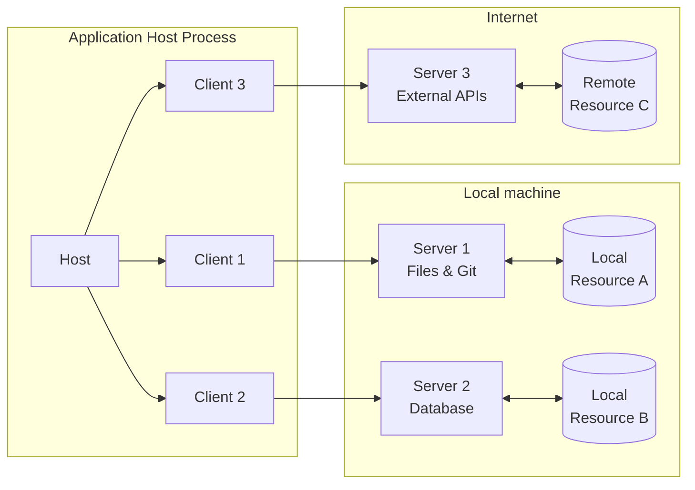
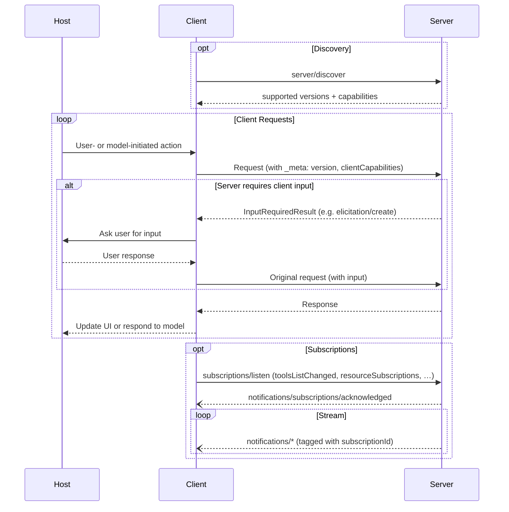
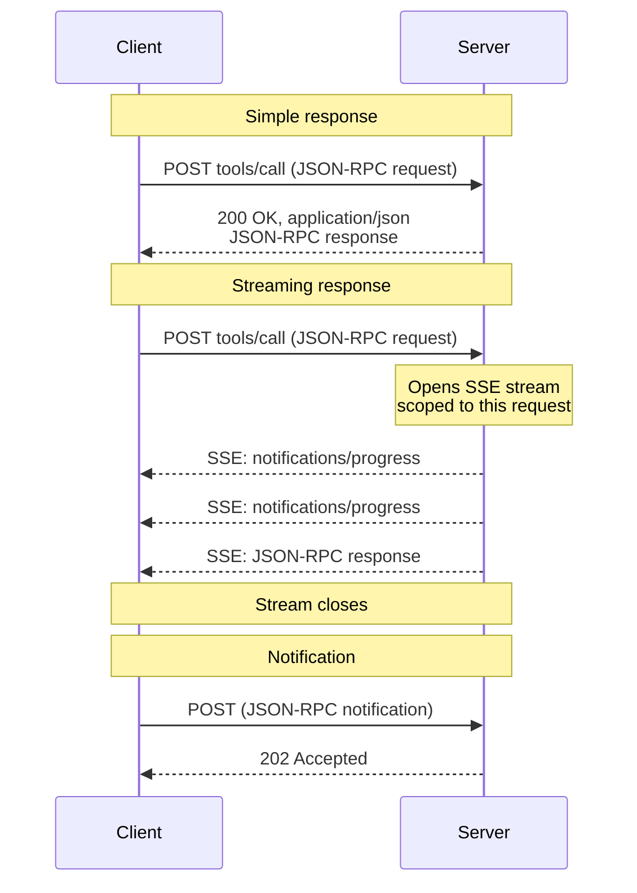
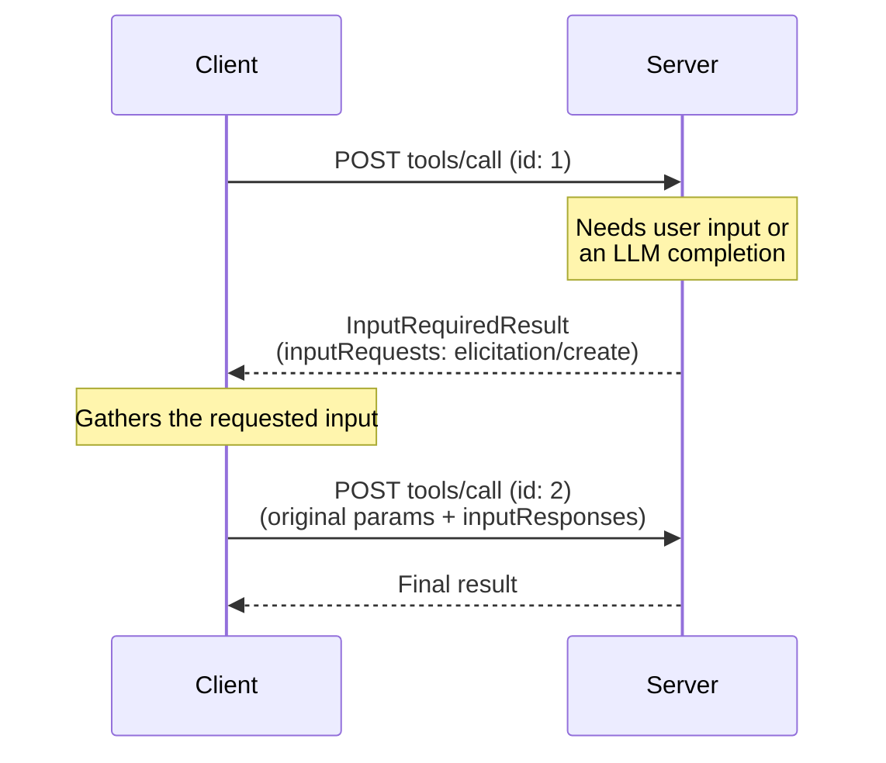
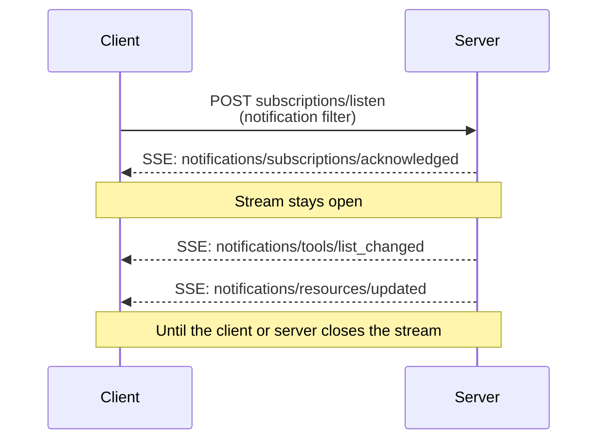
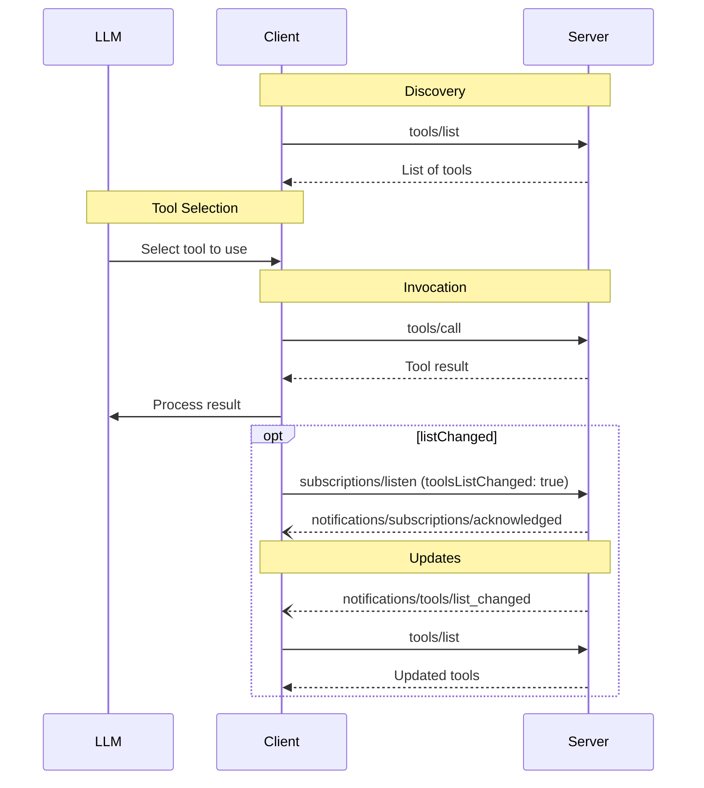

# Model Context Protocol Specification (revision 2026-07-28), selected pages

> Source: https://github.com/modelcontextprotocol/modelcontextprotocol (commit bbc31f8), docs/specification/2026-07-28.
> License: Apache-2.0 (some older contributions remain under MIT). MDX components were converted to plain Markdown; content is otherwise unchanged.


---

# Specification

_Page: https://modelcontextprotocol.io/specification/2026-07-28_

[Model Context Protocol](https://modelcontextprotocol.io) (MCP) is an open protocol that
enables seamless integration between LLM applications and external data sources and
tools. Whether you're building an AI-powered IDE, enhancing a chat interface, or creating
custom AI workflows, MCP provides a standardized way to connect LLMs with the context
they need.

This specification defines the authoritative protocol requirements, based on the
TypeScript schema in
[schema.ts](https://github.com/modelcontextprotocol/specification/blob/main/schema/2026-07-28/schema.ts).

For implementation guides and examples, visit
[modelcontextprotocol.io](https://modelcontextprotocol.io).

The key words "MUST", "MUST NOT", "REQUIRED", "SHALL", "SHALL NOT", "SHOULD", "SHOULD
NOT", "RECOMMENDED", "NOT RECOMMENDED", "MAY", and "OPTIONAL" in this document are to be
interpreted as described in [BCP 14](https://datatracker.ietf.org/doc/html/bcp14)
[[RFC2119](https://datatracker.ietf.org/doc/html/rfc2119)]
[[RFC8174](https://datatracker.ietf.org/doc/html/rfc8174)] when, and only when, they
appear in all capitals, as shown here.

## Overview

MCP provides a standardized way for applications to:

- Share contextual information with language models
- Expose tools and capabilities to AI systems
- Build composable integrations and workflows

The protocol uses [JSON-RPC](https://www.jsonrpc.org/) 2.0 messages to establish
communication between:

- **Hosts**: LLM applications that initiate connections
- **Clients**: Connectors within the host application
- **Servers**: Services that provide context and capabilities

MCP takes some inspiration from the
[Language Server Protocol](https://microsoft.github.io/language-server-protocol/), which
standardizes how to add support for programming languages across a whole ecosystem of
development tools. In a similar way, MCP standardizes how to integrate additional context
and tools into the ecosystem of AI applications.

## Key Details

### Base Protocol

- [JSON-RPC](https://www.jsonrpc.org/) message format
- Stateless, self-contained requests
- Per-request capability negotiation

### Features

Servers offer any of the following features to clients:

- **Resources**: Context and data, for the user or the AI model to use
- **Prompts**: Templated messages and workflows for users
- **Tools**: Functions for the AI model to execute

Clients may offer the following features to servers:

- **Elicitation**: Server requests for additional information from users

### Additional Utilities

- Configuration
- Progress tracking
- Cancellation
- Error reporting

### Extensions

Beyond the core protocol, MCP defines optional [extensions](/extensions/overview)
that add modular, specialized, or experimental functionality. Extensions
are always opt-in and require explicit support from both client and server, [negotiated
through capabilities](/extensions/overview#negotiation) that clients declare on each
request and servers declare in their `server/discover` result.
Notable extensions include:

- **[Tasks](/extensions/tasks/overview)**: Asynchronous execution of long-running
  operations, with polling, mid-flight input, and durable handles
- **[Skills over MCP](/community/working-groups/skills-over-mcp)**: Rich, structured
  instructions for agent workflows, discovered and consumed through MCP
- **[MCP Apps](/extensions/apps/overview)**: Interactive UI elements (charts, forms,
  video players) rendered inline within conversations

## Security and Trust & Safety

The Model Context Protocol enables powerful capabilities through arbitrary data access
and code execution paths. With this power comes important security and trust
considerations that all implementors must carefully address.

### Key Principles

1. **User Consent and Control**
   - Users must explicitly consent to and understand all data access and operations
   - Users must retain control over what data is shared and what actions are taken
   - Implementors should provide clear UIs for reviewing and authorizing activities

2. **Data Privacy**
   - Hosts must obtain explicit user consent before exposing user data to servers
   - Hosts must not transmit resource data elsewhere without user consent
   - User data should be protected with appropriate access controls

3. **Tool Safety**
   - Tools represent arbitrary code execution and must be treated with appropriate
     caution.
     - In particular, descriptions of tool behavior such as annotations should be
       considered untrusted, unless obtained from a trusted server.
   - Hosts must obtain explicit user consent before invoking any tool
   - Users should understand what each tool does before authorizing its use

### Implementation Guidelines

While MCP itself cannot enforce these security principles at the protocol level,
implementors **SHOULD**:

1. Build robust consent and authorization flows into their applications
2. Provide clear documentation of security implications
3. Implement appropriate access controls and data protections
4. Follow security best practices in their integrations
5. Consider privacy implications in their feature designs

## Learn More

Explore the detailed specification for each protocol component:

  - Architecture (/specification/2026-07-28/architecture)
  - Base Protocol (/specification/2026-07-28/basic)
  - Server Features (/specification/2026-07-28/server)
  - Client Features (/specification/2026-07-28/client)
  - Contributing (/community/contributing)


---

# Key Changes

_Page: https://modelcontextprotocol.io/specification/2026-07-28/changelog_

This document lists changes made to the Model Context Protocol (MCP) specification since
the previous revision, [2025-11-25](/specification/2025-11-25).

## Major changes

1. Remove protocol-level sessions and the `Mcp-Session-Id` header from the Streamable HTTP transport. List endpoints (`tools/list`, `resources/list`, `prompts/list`) no longer vary per-connection. Servers that need cross-call state use explicit, server-minted handles passed as ordinary tool arguments ([SEP-2567](https://github.com/modelcontextprotocol/modelcontextprotocol/pull/2567)).

2. Make MCP stateless: remove the `initialize`/`notifications/initialized` handshake. Every request now carries its protocol version and client capabilities in `_meta` (`io.modelcontextprotocol/protocolVersion`, `io.modelcontextprotocol/clientCapabilities`). Clients SHOULD identify themselves on each request (`io.modelcontextprotocol/clientInfo`), and servers SHOULD identify themselves in each result's `_meta` (`io.modelcontextprotocol/serverInfo`). Version mismatches return `UnsupportedProtocolVersionError` ([SEP-2575](https://github.com/modelcontextprotocol/modelcontextprotocol/pull/2575)).

3. Add `server/discover`: servers MUST implement this RPC to advertise their supported protocol versions, capabilities, and identity. Clients MAY call it before any other request for up-front version selection, or use it as a backward-compatibility probe on STDIO ([SEP-2575](https://github.com/modelcontextprotocol/modelcontextprotocol/pull/2575)).

4. Replace the HTTP GET endpoint and `resources/subscribe`/`resources/unsubscribe` with `subscriptions/listen`: a single long-lived POST-response stream for opted-in server-to-client change notifications. Clients opt in to specific types (`toolsListChanged`, `promptsListChanged`, `resourcesListChanged`, `resourceSubscriptions`); the server acknowledges and tags notifications with `io.modelcontextprotocol/subscriptionId`. Request-scoped notifications such as `notifications/progress` and `notifications/message` continue to flow on the response stream of the request they relate to, not the `subscriptions/listen` stream ([SEP-2575](https://github.com/modelcontextprotocol/modelcontextprotocol/pull/2575)).

5. Remove `ping`, `logging/setLevel`, and `notifications/roots/list_changed`. Log level is now set per-request via `io.modelcontextprotocol/logLevel` in `_meta`; servers MUST NOT emit `notifications/message` for requests that did not include this field ([SEP-2575](https://github.com/modelcontextprotocol/modelcontextprotocol/pull/2575)).

6. Move experimental tasks out of the core protocol and into an official extension (`io.modelcontextprotocol/tasks`). The redesigned extension replaces the blocking `tasks/result` method with polling via `tasks/get` and a new `tasks/update` for client-to-server input, removes `tasks/list`, and allows servers to return task handles unsolicited without per-request opt-in ([SEP-2663](https://github.com/modelcontextprotocol/modelcontextprotocol/pull/2663)).

7. Multi Round-Trip Requests (MRTR) pattern introduced which replaces the previous approach of sending server-initiated requests, such as `roots/list`, `sampling/createMessage`, or `elicitation/create`. Servers return an `InputRequiredResult` (`resultType: "input_required"`) whose `inputRequests` field carries the requests for the additional information needed to process the request. Clients respond with `inputResponses` on a retry of the original request providing the requested information. ([SEP-2322](https://github.com/modelcontextprotocol/modelcontextprotocol/pull/2322)).

8. All results now carry a required `resultType` field: `"complete"` for ordinary results and `"input_required"` for [multi round-trip request](/specification/2026-07-28/basic/patterns/mrtr) interim results. Clients **MUST** treat results from earlier-protocol servers that omit the field as `"complete"` ([SEP-2322](https://github.com/modelcontextprotocol/modelcontextprotocol/pull/2322)).

9. Remove SSE stream resumability and message redelivery (the `Last-Event-ID` header and SSE event IDs) from the Streamable HTTP transport. A broken response stream loses the in-flight request; clients **MUST** re-issue it as a new request with a new request ID ([SEP-2575](https://github.com/modelcontextprotocol/modelcontextprotocol/pull/2575)).

## Minor changes

1. Add `extensions` field to `ClientCapabilities` and `ServerCapabilities` to support optional [extensions](/docs/extensions/overview) beyond the core protocol.
2. Document OpenTelemetry trace context propagation conventions for `_meta` keys (`traceparent`, `tracestate`, `baggage`) ([SEP-414](https://github.com/modelcontextprotocol/modelcontextprotocol/pull/414)).
3. Servers **SHOULD** return tools from `tools/list` in a deterministic order to enable client-side caching and improve LLM prompt cache hit rates.
4. Require standard MCP request headers (`Mcp-Method`, `Mcp-Name`) on Streamable HTTP POST requests, and add support for custom headers from tool parameters via `x-mcp-header` ([SEP-2243](https://github.com/modelcontextprotocol/modelcontextprotocol/pull/2243)).
5. Require `ttlMs` and `cacheScope` fields on results returned by `tools/list`, `prompts/list`, `resources/list`, `resources/read`, and `resources/templates/list` via a new `CacheableResult` interface. `ttlMs` is a freshness hint (in milliseconds) allowing clients to cache responses and reduce polling; `cacheScope` (`"public"` or `"private"`) controls whether shared intermediaries may cache the response. Both fields complement existing `listChanged` notifications ([SEP-2549](https://github.com/modelcontextprotocol/modelcontextprotocol/pull/2549)).
6. Change resource not found error code from `-32002` to `-32602` (Invalid Params) to align with JSON-RPC specification ([SEP-2164](https://github.com/modelcontextprotocol/modelcontextprotocol/pull/2164)).
7. Authorization servers **SHOULD** include the `iss` parameter in authorization responses per
   [RFC 9207](https://datatracker.ietf.org/doc/html/rfc9207), and MCP clients **MUST** validate a
   present `iss` against the recorded issuer before redeeming the authorization code
   ([SEP-2468](https://github.com/modelcontextprotocol/modelcontextprotocol/pull/2468)).
8. Require MCP clients to specify an appropriate `application_type` during Dynamic Client
   Registration to avoid OpenID Connect redirect URI conflicts
   ([SEP-837](https://github.com/modelcontextprotocol/modelcontextprotocol/pull/837)).
9. Clarify that client credentials are bound to the authorization server that issued them:
   clients **MUST** key persisted credentials by the issuer identifier, **MUST NOT** reuse them
   with a different authorization server, and **MUST** re-register when the authorization server
   changes ([SEP-2352](https://github.com/modelcontextprotocol/modelcontextprotocol/pull/2352)).
10. Loosen `inputSchema` and `outputSchema` to allow any JSON Schema 2020-12 keywords, and
    `structuredContent` to allow any JSON value. Add `$ref` resolution requirements and
    composition-keyword resource bounds
    ([SEP-2106](https://github.com/modelcontextprotocol/modelcontextprotocol/pull/2106)).
11. Remove the `notifications/elicitation/complete` notification and the
    `elicitationId` field of URL mode elicitation requests, both introduced in
    `2025-11-25`. Under the
    [Multi Round-Trip Requests](/specification/2026-07-28/basic/patterns/mrtr) pattern, the
    client learns the outcome of an out-of-band interaction by retrying the original
    request, so a server-initiated completion signal — and the identifier used to
    correlate it — no longer fit the protocol. Servers needing to correlate an
    elicitation across retries encode their own identifier in `requestState`.
12. Define an [error code allocation policy](/specification/2026-07-28/basic/index#error-codes)
    partitioning the JSON-RPC server-error range: `-32000` to `-32019` remains
    implementation-defined (existing SDK usage is grandfathered), `-32020` to `-32099` is
    reserved for the MCP specification. Renumber the error codes introduced in this draft
    accordingly — `HeaderMismatch` `-32001` → `-32020`, `MissingRequiredClientCapability`
    `-32003` → `-32021`, `UnsupportedProtocolVersion` `-32004` → `-32022` — and add
    `HeaderMismatchError` to the schema, which previously existed only in transport prose.

## Deprecated

Features listed here remain part of the specification but are scheduled for removal under the [feature lifecycle and deprecation policy](/community/feature-lifecycle). New implementations should not adopt them. The [deprecated features registry](/specification/2026-07-28/deprecated) tracks every feature currently in the Deprecated state.

1. Deprecate the Roots, Sampling, and Logging features
   ([SEP-2577](https://github.com/modelcontextprotocol/modelcontextprotocol/pull/2577)).
   These features remain fully functional during the deprecation window but new
   implementations should not add support for them. Suggested migrations: pass
   directories or files via tool parameters, resource URIs, or server
   configuration instead of Roots; integrate directly with LLM provider APIs
   instead of Sampling; log to `stderr` (stdio) or use OpenTelemetry instead of
   Logging.

2. Reclassify the HTTP+SSE transport (deprecated since protocol version
   `2025-03-26`) as Deprecated under the feature lifecycle policy
   ([SEP-2596](https://github.com/modelcontextprotocol/modelcontextprotocol/pull/2596)).
   Migrate to [Streamable HTTP](/specification/2026-07-28/basic/transports/streamable-http).

3. Reclassify the `includeContext` values `"thisServer"` and `"allServers"`
   (soft-deprecated since protocol version `2025-11-25`) as Deprecated
   ([SEP-2596](https://github.com/modelcontextprotocol/modelcontextprotocol/pull/2596)).
   Omit the field or use `"none"`; these values will be removed no later than
   the Sampling feature itself.

4. Deprecate the OAuth 2.0 Dynamic Client Registration Protocol
   ([RFC7591](https://datatracker.ietf.org/doc/html/rfc7591)) as a client registration
   mechanism in favor of
   [Client ID Metadata Documents](/specification/2026-07-28/basic/authorization/client-registration#client-id-metadata-documents)
   ([PR #2858](https://github.com/modelcontextprotocol/modelcontextprotocol/pull/2858)).
   It remains available for backwards compatibility with authorization servers that do
   not support Client ID Metadata Documents.

## Other schema changes

1. `schema.json` now correctly reflects that the Typescript definition of minimum/maximum/default are `number`'s and not just `integers`. This was caused by running the generator using `--defaultNumberType integer` ([PR#2710](https://github.com/modelcontextprotocol/modelcontextprotocol/pull/2710)).

## Governance and process updates

1. Adopt a specification
   [feature lifecycle and deprecation policy](/community/feature-lifecycle)
   defining the Active, Deprecated, and Removed feature states, a minimum
   twelve-month deprecation window, and a
   [registry of deprecated features](/specification/2026-07-28/deprecated)
   ([SEP-2596](https://github.com/modelcontextprotocol/modelcontextprotocol/pull/2596)).

## Process changes

1. Formalize PR-based SEP workflow with markdown files in `seps/` directory, PR-derived numbering, sponsor responsibilities, and status management via PR labels ([SEP-1850](https://github.com/modelcontextprotocol/specification/pull/1850)).

## Full changelog

For a complete list of all changes that have been made since the last protocol revision,
[see GitHub](https://github.com/modelcontextprotocol/specification/compare/2025-11-25...2026-07-28).


---

# Architecture

_Page: https://modelcontextprotocol.io/specification/2026-07-28/architecture_

The Model Context Protocol (MCP) follows a client-host-server architecture where each
host can run multiple client instances. MCP is a stateless protocol: every request is
self-contained and carries its own protocol version and capabilities.
This architecture enables users to integrate AI capabilities across applications while
maintaining clear security boundaries and isolating concerns. Built on JSON-RPC, MCP
provides a protocol focused on context exchange between clients and servers.

## Core Components



### Host

The host process acts as the container and coordinator:

- Creates and manages multiple client instances
- Controls client connection permissions and lifecycle
- Enforces security policies and consent requirements
- Handles user authorization decisions
- Coordinates AI/LLM integration
- Manages context aggregation across clients

### Clients

Each client is created by the host and communicates with exactly one server:

- Communicates with exactly one server
- Attaches protocol version and capabilities to every request
- Routes protocol messages bidirectionally
- Manages subscriptions and notifications
- Maintains security boundaries between servers

A host application creates and manages multiple clients, with each client having a 1:1
relationship with a particular server.

### Servers

Servers provide specialized context and capabilities:

- Expose resources, tools and prompts via MCP primitives
- Operate independently with focused responsibilities
- Request client input (e.g. elicitation[^deprecated-input]) via `InputRequiredResult` within a reply
- Must respect security constraints
- Can be local processes or remote services

[^deprecated-input]: Sampling and roots requests are also delivered via `InputRequiredResult`, but both are deprecated as of protocol version `2026-07-28` and should not be used in new implementations. See [Deprecated Features](/specification/2026-07-28/deprecated).

## Design Principles

MCP is built on several key design principles that inform its architecture and
implementation:

1. **Servers should be extremely easy to build**
   - Host applications handle complex orchestration responsibilities
   - Servers focus on specific, well-defined capabilities
   - Simple interfaces minimize implementation overhead
   - Clear separation enables maintainable code

2. **Servers should be highly composable**
   - Each server provides focused functionality in isolation
   - Multiple servers can be combined seamlessly
   - Shared protocol enables interoperability
   - Modular design supports extensibility

3. **Servers should not be able to read the whole conversation, nor "see into" other
   servers**
   - Servers receive only necessary contextual information
   - Full conversation history stays with the host
   - Each server maintains isolation
   - Cross-server interactions are controlled by the host
   - Host process enforces security boundaries

4. **Features can be added to servers and clients progressively**
   - Core protocol provides minimal required functionality
   - Additional capabilities can be negotiated as needed
   - Servers and clients evolve independently
   - Protocol designed for future extensibility
   - Backwards compatibility is maintained

## Capability Negotiation

The Model Context Protocol uses a capability-based negotiation system where clients and
servers declare their supported features. Clients include their
capabilities in `_meta.io.modelcontextprotocol/clientCapabilities` on every request.
Servers advertise their capabilities in response to
[`server/discover`](/specification/2026-07-28/server/discover), which clients may call before
any other request for up-front capability discovery.

- Servers declare capabilities like tool support, resource subscriptions, and prompt
  templates
- Clients declare capabilities like elicitation handling
- Both parties must respect declared capabilities throughout the interaction
- Additional capabilities can be negotiated through extensions to the protocol



Each capability unlocks specific protocol features on a per-request basis. For example:

- Implemented [server features](/specification/2026-07-28/server) must be advertised in the
  server's capabilities
- Receiving resource update notifications requires opening a
  [`subscriptions/listen`](/specification/2026-07-28/basic/patterns/subscriptions) stream
  with the desired resource URIs
- [Tool](/specification/2026-07-28/server/tools) invocation requires the server to declare tool capabilities

This capability negotiation ensures clients and servers have a clear understanding of
supported functionality while maintaining protocol extensibility.


---

# Overview

_Page: https://modelcontextprotocol.io/specification/2026-07-28/basic/transports_

This page defines what a transport must provide to carry MCP messages, the
standard transport bindings, and the requirements for defining new ones.

Protocol semantics are identical on every transport. A transport is a
**binding**: it defines how messages are framed and delivered, how request
metadata is carried, and how cancellation and termination are signaled. It
does not define what the messages mean: the
[message patterns](/specification/2026-07-28/basic/patterns) are part of the core
protocol and are the same on every binding. The binding pages specify the
standard transports:

1. [stdio](/specification/2026-07-28/basic/transports/stdio): newline-delimited
   messages over the standard streams of a client-launched subprocess.
2. [Streamable HTTP](/specification/2026-07-28/basic/transports/streamable-http):
   each message is an HTTP POST to a single MCP endpoint; replies arrive as
   a JSON object or a request-scoped SSE stream.

It is also possible for clients and servers to implement
[custom transports](#custom-transports).

## Messages

MCP uses JSON-RPC to encode messages. JSON-RPC messages **MUST** be UTF-8
encoded.

A binding **MUST** deliver client-sent _requests_ and _notifications_ to the
server, and server-sent _responses_ and _notifications_ to the client. No
other message direction exists: per the
[message patterns](/specification/2026-07-28/basic/patterns), servers do not
initiate JSON-RPC requests and clients do not send JSON-RPC responses.

## Request Metadata

All protocol metadata travels in the message body: every request carries its
protocol version and client capabilities in
[`_meta.io.modelcontextprotocol/*`](/specification/2026-07-28/basic/index#_meta)
fields.

A binding **MAY** additionally mirror selected body fields into envelope
metadata. The Streamable HTTP transport mirrors them into
[HTTP headers](/specification/2026-07-28/basic/transports/streamable-http#request-metadata)
so that intermediaries can route and inspect requests without parsing the
body. The body remains the source of truth; bindings that mirror metadata
define how mismatches are rejected.

## Cancellation

Each binding defines how a client abandons an in-flight request: on stdio
the client sends a `notifications/cancelled` notification; on Streamable
HTTP it closes the request's response stream. The protocol-level rules are
the same everywhere; see
[Cancellation](/specification/2026-07-28/basic/patterns/cancellation).

## Custom Transports

Clients and servers **MAY** implement additional custom transport mechanisms
to suit their specific needs. The protocol is transport-agnostic and can be
implemented over any communication channel that supports bidirectional
message exchange.

Implementers who choose to support custom transports **MUST** preserve the
JSON-RPC message format, the
[message patterns](/specification/2026-07-28/basic/patterns), and the per-request
metadata model. Custom transports **SHOULD** document their connection
establishment, message framing, and cancellation patterns to aid
interoperability.

Custom transports that run over a reliable bidirectional byte stream (e.g.,
Unix domain sockets or TCP) **SHOULD** reuse the
[stdio framing](/specification/2026-07-28/basic/transports/stdio) rather than
defining a new one: the stdio binding is just newline-delimited JSON-RPC
over a byte stream, and only its process-lifecycle rules are specific to
standard streams.

## Backward Compatibility

Earlier protocol revisions established a connection-scoped session with an
`initialize` handshake and allowed servers to initiate JSON-RPC requests.
Clients and servers that interoperate with those revisions detect the
counterpart's era and fall back as described in
[Versioning: Backward Compatibility](/specification/2026-07-28/basic/versioning#backward-compatibility-with-initialization-based-versions),
which includes a compatibility matrix for implementors. Each binding page
describes its transport-specific detection mechanics.


---

# stdio

_Page: https://modelcontextprotocol.io/specification/2026-07-28/basic/transports/stdio_

In the **stdio** transport, the client launches the MCP server as a subprocess.
The two ends communicate over the subprocess's standard streams:

- The server reads JSON-RPC messages from `stdin` and writes JSON-RPC messages to
  `stdout`.
- Each message is a single JSON-RPC request, notification, or response.
- Messages are delimited by newlines, and **MUST NOT** contain embedded newlines.
- The server **MAY** write UTF-8 strings to `stderr` for any logging purposes
  including informational, debug, and error messages.
- The client **MAY** capture, forward, or ignore the server's `stderr` output and
  **SHOULD NOT** assume `stderr` output indicates error conditions.
- The server **MUST NOT** write anything to its `stdout` that is not a valid MCP
  message.
- The client **MUST NOT** write anything to the server's `stdin` that is not a
  valid MCP message.

Standard streams are the canonical channel, but nothing in this binding
depends on them except the process lifecycle. The wire format (one
newline-delimited JSON-RPC message per line over a reliable bidirectional
byte stream) works unchanged over Unix domain sockets, TCP connections, or
any similar channel.
[Custom transports](/specification/2026-07-28/basic/transports#custom-transports)
built on such streams **SHOULD** reuse this framing and the message rules on
this page; only the subprocess-specific aspects (launch, `stderr`, shutdown
by closing the stream, process restart) need channel-specific equivalents.

## Sending Messages

The client sends messages by writing JSON-RPC _requests_ and _notifications_
to the server's `stdin`, one message per line. The client **MUST NOT** write
JSON-RPC _responses_.

## Receiving Messages

The client reads server messages from `stdout`, one message per line. All
messages share this single channel; there are no per-request streams.

The server writes three kinds of messages:

1. _Responses_ to client requests, correlated by JSON-RPC `id`.
2. _Notifications_ that relate to an in-flight request, such as
   `notifications/progress` and `notifications/message`.
3. _Notifications_ delivered for an active
   [`subscriptions/listen`][subscriptions-listen] request. Clients **MUST**
   correlate these using the `io.modelcontextprotocol/subscriptionId` field
   in `_meta`; see
   [`SubscriptionsListenRequest`][subscriptions-listen-request].

The server **MUST NOT** write JSON-RPC _requests_ to `stdout`.
Server-to-client interactions are carried in
[`InputRequiredResult`][mrtr-input-required] replies; see
[Multi Round-Trip Requests][mrtr].

[mrtr]: /specification/2026-07-28/basic/patterns/mrtr
[mrtr-input-required]: /specification/2026-07-28/basic/patterns/mrtr#inputrequiredresult
[subscriptions-listen]: /specification/2026-07-28/basic/patterns/subscriptions
[subscriptions-listen-request]: /specification/2026-07-28/schema#subscriptionslistenrequest

## Request Metadata

All request metadata for the stdio transport is carried inline in the
JSON-RPC message body. The protocol version, per-request capabilities, and
optional client identity live in
[`_meta.io.modelcontextprotocol/*`][meta-fields];
the method name and arguments live where JSON-RPC puts them. There is no
header layer.

[meta-fields]: /specification/2026-07-28/basic/index#_meta

## Cancellation

To cancel an in-flight request, the client **MUST** send a
`notifications/cancelled` notification referencing the request's ID. Because
stdio is a single shared bidirectional channel, there is no per-request stream
to close. Servers **SHOULD** stop work on a cancelled request as soon as
practical and **MUST NOT** send any further messages for it. See
[Cancellation][cancellation] for the full rules.

[cancellation]: /specification/2026-07-28/basic/patterns/cancellation

## Shutdown

The client **SHOULD** initiate shutdown by:

1. Closing the input stream to the child process (the server).
2. Waiting for the server to exit.
3. If the server does not exit within a reasonable time, forcibly terminating
   the process using the mechanism appropriate for the operating system.

On POSIX systems, forced termination typically escalates from
[`SIGTERM`][sigterm]
to `SIGKILL`. On Windows, where POSIX signals are not available, clients can
use [`TerminateProcess`][terminateprocess]
or [Job Objects][job-objects].

Servers **SHOULD** exit promptly when their standard input is closed or reads
return end-of-file. This is the primary graceful-shutdown signal and the only
portable one, so honoring it reduces the need for forced termination.

The server **MAY** initiate shutdown by closing its output stream to the
client and exiting.

## Unexpected Termination

If the server process exits unexpectedly, the client **SHOULD** restart it.
Because the protocol is stateless, any in-flight requests are simply lost and
the client can retry them against the fresh process. Active
[`subscriptions/listen`][subscriptions-listen] streams must also be
re-established after restart.

[sigterm]: https://pubs.opengroup.org/onlinepubs/9699919799/basedefs/signal.h.html
[terminateprocess]: https://learn.microsoft.com/windows/win32/api/processthreadsapi/nf-processthreadsapi-terminateprocess
[job-objects]: https://learn.microsoft.com/windows/win32/procthread/job-objects

## Backward Compatibility

A client that supports both modern (per-request-metadata) MCP versions and a
legacy version that requires an `initialize` handshake **SHOULD** probe with
[`server/discover`][server-discover] before sending any other request,
setting its preferred modern version in `_meta`. The probe has three
possible outcomes:

- The server returns a `DiscoverResult`: the server is modern. Select a
  mutually supported version from `supportedVersions` and continue.
- The server returns a recognized modern JSON-RPC error such as
  [`UnsupportedProtocolVersionError`][unsupported-version]: the server is
  modern but does not support the requested version. Use one of the versions
  in its advertised `supported` list. Do **not** fall back to `initialize`.
- The server returns any other error, or does not respond within a
  reasonable timeout: the server is legacy. Fall back to the `initialize`
  handshake.

The fallback **MUST NOT** be keyed to one specific error code: legacy servers
respond to unknown pre-`initialize` requests with implementation-defined
errors (commonly `-32601` or `-32602`) or not at all.

A client that only supports modern versions does not need to probe, but
probing is still **RECOMMENDED**: some legacy servers do not validate that a
request arrives after `initialize` and would process an era-ambiguous method
(such as `tools/call`) under legacy semantics. Probing yields a
deterministic failure instead.

See [Versioning: Backward Compatibility][lifecycle-compat] for the era model
and a compatibility matrix for implementors.

[server-discover]: /specification/2026-07-28/schema#discoverrequest
[unsupported-version]: /specification/2026-07-28/schema#unsupportedprotocolversionerror
[lifecycle-compat]: /specification/2026-07-28/basic/versioning#backward-compatibility-with-initialization-based-versions


---

# Streamable HTTP

_Page: https://modelcontextprotocol.io/specification/2026-07-28/basic/transports/streamable-http_

> **Info:** Streamable HTTP was introduced in protocol version 2025-03-26 as a replacement
for the [HTTP+SSE transport][http-sse] from protocol version 2024-11-05.

> **Info:** Revision 2026-07-28 changed the behavior of Streamable HTTP. Clients must
ensure they handle backwards compatibility correctly. Changes included:

- Removal of the GET stream endpoint.
- Removal of protocol-level sessions.

See the [changelog](/specification/2026-07-28/changelog) and
[Backward Compatibility](#backward-compatibility) below.

In the **Streamable HTTP** transport, the server operates as an independent
process that can handle multiple client connections. At a glance:

- The server exposes a single HTTP endpoint (the **MCP endpoint**) that
  accepts POST.
- The client sends every JSON-RPC request or notification as its own HTTP
  POST.
- The server answers each request with either a single JSON object or a
  [Server-Sent Events][sse] (SSE) stream scoped to that request, carrying
  request-related notifications followed by the final response.
- Server-to-client interactions (sampling, elicitation, roots) are embedded
  in results as input requests per
  [Multi Round-Trip Requests (MRTR)][mrtr] ([SEP-2322][sep-2322]).
- Long-lived change notifications (such as list changes and resource updates)
  are delivered on the response stream of a
  [`subscriptions/listen`][subscriptions-listen] request.

See [Message Flow](#message-flow) for sequence diagrams of these
interactions.

The server **MUST** provide a single HTTP endpoint path (hereafter referred to
as the **MCP endpoint**) that supports POST. For example, this could be a URL
like `https://example.com/mcp`.

[http-sse]: /specification/2024-11-05/basic/transports#http-with-sse
[sse]: https://en.wikipedia.org/wiki/Server-sent_events

## Security & Endpoint

When implementing Streamable HTTP transport:

1. Servers **MUST** validate the `Origin` header on all incoming connections
   to prevent DNS rebinding attacks.
   - If the `Origin` header is present and invalid, servers **MUST** respond
     with HTTP 403 Forbidden. The HTTP response body **MAY** comprise a
     JSON-RPC _error response_ that has no `id`.
2. When running locally, servers **SHOULD** bind only to localhost
   (127.0.0.1) rather than all network interfaces (0.0.0.0).
3. Servers **SHOULD** implement proper authentication for all connections.

Without these protections, attackers could use DNS rebinding to interact with
local MCP servers from remote websites.

## Sending Messages

Every JSON-RPC message sent from the client **MUST** be a new HTTP POST
request to the MCP endpoint.

1. The client **MUST** use HTTP POST to send JSON-RPC messages.
2. The client **MUST** include an `Accept` header listing both
   `application/json` and `text/event-stream` as supported content types.
3. The client **MUST** include the [request metadata headers](#request-metadata)
   on each POST request.
4. The body of the HTTP POST **MUST** be a single JSON-RPC _request_ or
   _notification_. The client **MUST NOT** send JSON-RPC _responses_.
5. If the body is a JSON-RPC _notification_:
   - If the server accepts it, the server **MUST** return HTTP status code
     `202 Accepted` with no body.
   - If the server cannot accept it, it **MUST** return an HTTP error status
     code (e.g., `400 Bad Request`). The HTTP response body **MAY** comprise
     a JSON-RPC _error response_ that has no `id`.
6. If the body is a JSON-RPC _request_, the server **MUST** return either
   `Content-Type: application/json` (a single JSON object) or
   `Content-Type: text/event-stream` (an SSE response stream). The client
   **MUST** support both.

> **Note:** This revision of the core protocol defines no client-to-server
_notifications_ over Streamable HTTP. The only client-sent notification in
the core protocol, `notifications/cancelled`, is used only on the
[stdio](/specification/2026-07-28/basic/transports/stdio) transport; on
Streamable HTTP, closing the SSE response stream is itself the cancellation
signal and no `notifications/cancelled` message is expected (see
[Cancellation][cancellation]). The notification rules above describe the
transport mechanics for a notification POST; header requirements for
notification POSTs are not defined by this revision.

## Receiving Messages

When the server returns an SSE response stream
(`Content-Type: text/event-stream`):

- The server **MAY** send JSON-RPC _notifications_ — for example,
  [`notifications/progress`][notifications-progress]
  or [`notifications/message`][notifications-message] —
  before the final response. These notifications **MUST** relate to the
  originating client request.
- The server **MUST NOT** send independent JSON-RPC _requests_ on this stream.
  Server-to-client interactions (sampling, elicitation, list-roots) are
  embedded as input requests inside an
  [`InputRequiredResult`][input-required-result] per
  [MRTR][mrtr] ([SEP-2322][sep-2322]), not delivered as separate requests on
  this or any other stream. This is a change from Streamable HTTP in protocol
  versions `2025-03-26` through `2025-11-25`, where servers could send such
  requests on SSE streams.
- The final JSON-RPC _response_ **SHOULD** terminate the stream.

Long-lived notification streams are obtained by sending a
[`subscriptions/listen`][subscriptions-listen]
request. The server's response is itself an SSE stream that stays open and
delivers the change notifications the client opted in to (such as
`notifications/tools/list_changed` or `notifications/resources/updated`).
Request-scoped notifications like `notifications/progress` and
`notifications/message` are **not** delivered on the listen stream — they
flow only on the response stream of the request they relate to.

When initiating an SSE stream, servers **SHOULD** include the
`X-Accel-Buffering: no` header in the HTTP response. This instructs reverse
proxies (such as nginx) to disable response buffering, ensuring that SSE
events are delivered to clients immediately rather than being held in a
buffer. Without this header, proxies may accumulate messages before sending
them to the client, introducing unwanted latency and potentially breaking the
real-time nature of SSE communication.

> **Note:** For long-lived streams — in particular the
[`subscriptions/listen`][subscriptions-listen] response stream — servers are
encouraged to periodically emit an SSE comment line (a line beginning with a
colon, e.g. `:\r\n`) as a keep-alive. This keeps the connection from being
closed by intermediaries or client idle timeouts during quiet periods when no
notifications are flowing. Per the [SSE specification][sse], any line beginning
with a colon is a comment that carries no event data; clients must ignore such
lines and must not treat them as malformed input.

Resumable SSE streams via `Last-Event-ID` are not supported.

[notifications-progress]: /specification/2026-07-28/basic/patterns/progress
[notifications-message]: /specification/2026-07-28/server/utilities/logging
[input-required-result]: /specification/2026-07-28/schema#inputrequiredresult
[mrtr]: /specification/2026-07-28/basic/patterns/mrtr
[sep-2322]: /seps/2322-MRTR
[subscriptions-listen]: /specification/2026-07-28/basic/patterns/subscriptions

## Message Flow

The following diagrams illustrate the message flows on a single MCP endpoint.

**Requests and responses.** Each request is its own POST; the server chooses
per request whether to respond with a single JSON object or an SSE stream:



**Server-to-client interactions (MRTR).** When the server needs input from
the client — sampling, elicitation, or roots — it does not send its own
JSON-RPC request. It returns an
[`InputRequiredResult`][input-required-result] containing `inputRequests`,
and the client retries the original request with the matching
`inputResponses` (see [Multi Round-Trip Requests][mrtr]):



**Change notifications.** Clients that want server-initiated change
notifications open a long-lived stream with
[`subscriptions/listen`][subscriptions-listen]; the response stream stays
open and carries only the notification types the client opted in to:



## Cancellation

Closing the SSE response stream **MUST** be treated by the server as
cancellation of that request. Because each request has its own response
stream, the transport-level disconnect is unambiguous. The server **SHOULD**
stop work on the cancelled request as soon as practical and **MUST NOT** send
any further messages for it. See
[Cancellation][cancellation] for the full rules.

[cancellation]: /specification/2026-07-28/basic/patterns/cancellation

## Request Metadata

The Streamable HTTP transport mirrors selected JSON-RPC body fields into HTTP
headers so that intermediaries (load balancers, gateways, observability
tooling) can route and inspect requests without parsing the body.

### Protocol Version Header

Every POST request to the MCP endpoint **MUST** include an
`MCP-Protocol-Version` header.

For example: `MCP-Protocol-Version: 2026-07-28`

The header value **MUST** match the
`io.modelcontextprotocol/protocolVersion` field carried in the request body's
`_meta`. If the values do not match, the server **MUST** reject the request
with `400 Bad Request` and a `HeaderMismatch` JSON-RPC error
(see [Server Validation](#server-validation)).

If the server does not implement the requested protocol version (whether the
version is unknown to the server, or is a known version the server has chosen
not to support), it **MUST** respond with `400 Bad Request` and an
[`UnsupportedProtocolVersionError`][unsupported-version]
listing its supported versions. See
[Versioning: Protocol Version Negotiation][lifecycle-version]
for the negotiation flow.

If the server does not implement the requested RPC method, it **MUST** respond
with `404 Not Found` and a JSON-RPC error with code `-32601`
(`Method not found`). The JSON-RPC error body distinguishes this case from a
`404` returned by a legacy [HTTP+SSE][http-sse] server that does not host the
modern MCP endpoint (see [Backward Compatibility](#backward-compatibility)).

A server that supports clients implementing protocol versions earlier than
`2025-06-18` (which did not define the `MCP-Protocol-Version` header) **MAY**
treat a request that omits the header as protocol version `2025-03-26`. A
server that does not support such clients **MUST** reject a request without
the header per [Server Validation](#server-validation).

[unsupported-version]: /specification/2026-07-28/schema#unsupportedprotocolversionerror
[lifecycle-version]: /specification/2026-07-28/basic/versioning#protocol-version-negotiation

### Standard Request Headers

| Header Name  | Source Field                  | Required For                                           |
| ------------ | ----------------------------- | ------------------------------------------------------ |
| `Mcp-Method` | `method`                      | All requests                                           |
| `Mcp-Name`   | `params.name` or `params.uri` | `tools/call`, `resources/read`, `prompts/get` requests |

These headers are **REQUIRED** for compliance.

If the `Mcp-Name` source value cannot be safely represented as a plain ASCII
header value, clients **MUST** encode it using the Base64 sentinel format
described in [Value Encoding](#value-encoding).

**`tools/call` request:**

```http
POST /mcp HTTP/1.1
Host: example.com
Content-Type: application/json
Accept: application/json, text/event-stream
MCP-Protocol-Version: 2026-07-28
Mcp-Method: tools/call
Mcp-Name: get_weather

{
  "jsonrpc": "2.0",
  "id": 1,
  "method": "tools/call",
  "params": {
    "name": "get_weather",
    "arguments": {
      "location": "Seattle, WA"
    },
    "_meta": {
      "io.modelcontextprotocol/protocolVersion": "2026-07-28",
      "io.modelcontextprotocol/clientInfo": {
        "name": "ExampleClient",
        "version": "1.0.0"
      },
      "io.modelcontextprotocol/clientCapabilities": {}
    }
  }
}
```

**`resources/read` request:**

```http
POST /mcp HTTP/1.1
Host: example.com
Content-Type: application/json
Accept: application/json, text/event-stream
MCP-Protocol-Version: 2026-07-28
Mcp-Method: resources/read
Mcp-Name: file:///projects/myapp/config.json

{
  "jsonrpc": "2.0",
  "id": 2,
  "method": "resources/read",
  "params": {
    "uri": "file:///projects/myapp/config.json",
    "_meta": {
      "io.modelcontextprotocol/protocolVersion": "2026-07-28",
      "io.modelcontextprotocol/clientInfo": {
        "name": "ExampleClient",
        "version": "1.0.0"
      },
      "io.modelcontextprotocol/clientCapabilities": {}
    }
  }
}
```

### Custom Headers from Tool Parameters

MCP servers **MAY** designate specific tool parameters to be mirrored into
HTTP headers using an `x-mcp-header` extension property in the parameter's
schema within the tool's `inputSchema`. See
[Tool Definitions][tool-definitions] for
details on how to annotate tool parameters.

While the use of `x-mcp-header` is optional for servers, clients **MUST**
support this feature. When a server's tool definition includes
`x-mcp-header` annotations, conforming clients **MUST** mirror the
designated parameter values into HTTP headers.

[tool-definitions]: /specification/2026-07-28/server/tools#x-mcp-header

#### Schema Extension

The `x-mcp-header` property specifies the name portion used to construct
the header name `Mcp-Param-{name}`.

**Constraints on `x-mcp-header` values**:

- **MUST NOT** be empty
- **MUST** match HTTP field-name token syntax (`1*tchar`, [RFC 9110 Section 5.1](https://datatracker.ietf.org/doc/html/rfc9110#section-5.1))
- **MUST NOT** contain control characters, including carriage return (CR, `\r`)
  or line feed (LF, `\n`)
- **MUST** be case-insensitively unique among all `x-mcp-header` values in
  the `inputSchema`
- **MUST** only be applied to parameters with primitive types (integer,
  string, boolean). Parameters with type `number` are not permitted.
  Integer values **MUST** be within the safe range for JavaScript
  (−2<sup>53</sup>+1 to 2<sup>53</sup>−1)
- **MUST** only be applied to properties that are _statically reachable_
  from the schema root: reachable via a chain consisting solely of
  `properties` keys. The chain **MUST NOT** pass through `items` (or any
  other array keyword), composition keywords (`oneOf`, `anyOf`, `allOf`,
  `not`), conditional keywords (`if`/`then`/`else`), or `$ref`. Nested
  object properties are permitted as long as every step in the chain is a
  `properties` key. An `x-mcp-header` annotation anywhere else makes the
  annotation — and thus the tool definition — invalid.

Header extraction is defined as reading the instance value at the exact
property path of the annotated property (the chain of `properties` keys
leading to it). If no value is present at that path in the call arguments,
the header is omitted.

Clients using the Streamable HTTP transport **MUST** reject tool definitions
where any `x-mcp-header` value violates these constraints. Rejection means
the client **MUST** exclude the invalid tool from the result of `tools/list`.
Clients **SHOULD** log a warning when rejecting a tool definition, including
the tool name and the reason for rejection. This ensures that a single
malformed tool definition does not prevent other valid tools from being used.
Clients using other transports (e.g., stdio) **MAY** ignore `x-mcp-header`
annotations entirely.

**Example tool definition:**

```json
{
  "name": "execute_sql",
  "description": "Execute SQL on Google Cloud Spanner",
  "inputSchema": {
    "type": "object",
    "properties": {
      "region": {
        "type": "string",
        "description": "The region to execute the query in",
        "x-mcp-header": "Region"
      },
      "query": {
        "type": "string",
        "description": "The SQL query to execute"
      }
    },
    "required": ["region", "query"]
  }
}
```

**Resulting HTTP request:**

```http
POST /mcp HTTP/1.1
Host: example.com
Content-Type: application/json
Accept: application/json, text/event-stream
MCP-Protocol-Version: 2026-07-28
Mcp-Method: tools/call
Mcp-Name: execute_sql
Mcp-Param-Region: us-west1

{
  "jsonrpc": "2.0",
  "id": 1,
  "method": "tools/call",
  "params": {
    "_meta": {
      "io.modelcontextprotocol/protocolVersion": "2026-07-28",
      "io.modelcontextprotocol/clientInfo": {
        "name": "ExampleClient",
        "version": "1.0.0"
      },
      "io.modelcontextprotocol/clientCapabilities": {}
    },
    "name": "execute_sql",
    "arguments": {
      "region": "us-west1",
      "query": "SELECT * FROM users"
    }
  }
}
```

#### Value Encoding

Clients **MUST** encode parameter values before including them in HTTP
headers to ensure safe transmission and prevent injection attacks.

**Type conversion**: Convert the parameter value to its string representation:

- `string`: Use the value as-is
- `integer`: Convert to decimal string representation (e.g., `42`, `-7`)
- `boolean`: Convert to lowercase `"true"` or `"false"`

Per [RFC 9110][rfc9110-values],
HTTP header field values must consist of visible ASCII characters
(0x21-0x7E), space (0x20), and horizontal tab (0x09). When a value cannot
be safely represented as a plain ASCII header value (e.g., it contains
non-ASCII characters, control characters, or has leading/trailing
whitespace), clients **MUST** use Base64 encoding of the UTF-8
representation with the following format:

```text
Mcp-Param-{Name}: =?base64?{Base64EncodedValue}?=
```

The same encoding rule applies to the `Mcp-Name` header value. Tool and
prompt names are only **SHOULD**-constrained to header-safe characters, so a
name (or resource URI) outside the safe set is carried as:

```text
Mcp-Name: =?base64?{Base64EncodedValue}?=
```

The prefix `=?base64?` and suffix `?=` indicate that the value is
Base64-encoded. These markers are case-sensitive and **MUST** appear exactly
as shown (lowercase). Servers and intermediaries that need to inspect these
values **MUST** decode them accordingly. In particular, servers **MUST**
decode an encoded `Mcp-Name` or `Mcp-Param-{Name}` value before comparing it
to the corresponding request body value during
[Server Validation](#server-validation).

To avoid ambiguity, clients **MUST** also Base64-encode any plain-ASCII
value that matches the sentinel pattern (i.e., starts with `=?base64?`
and ends with `?=`).

**Encoding examples:**

| Original Value         | Reason                   | Encoded Header Value                                  |
| ---------------------- | ------------------------ | ----------------------------------------------------- |
| `"us-west1"`           | Plain ASCII              | `Mcp-Param-Region: us-west1`                          |
| `"Hello, 世界"`        | Contains non-ASCII       | `Mcp-Param-Greeting: =?base64?SGVsbG8sIOS4lueVjA==?=` |
| `" padded "`           | Leading/trailing spaces  | `Mcp-Param-Text: =?base64?IHBhZGRlZCA=?=`             |
| `"line1\nline2"`       | Contains newline         | `Mcp-Param-Text: =?base64?bGluZTEKbGluZTI=?=`         |
| `"=?base64?literal?="` | Matches sentinel pattern | `Mcp-Param-Val: =?base64?PT9iYXNlNjQ/bGl0ZXJhbD89?=`  |

[rfc9110-values]: https://datatracker.ietf.org/doc/html/rfc9110#name-field-values

#### Client Behavior

When constructing a `tools/call` request via HTTP transport, the client
**MUST**:

1. Extract the values for any standard headers from the request body (e.g.,
   `method`, `params.name`, `params.uri`).
2. Append the `Mcp-Method` header and, if applicable, `Mcp-Name` header to
   the request.
3. Inspect the tool's `inputSchema` for properties marked with
   `x-mcp-header` and extract the value at each annotated property's exact
   property path, omitting the header when no value is present (see
   [Schema Extension](#schema-extension)).
4. Encode the values according to the [Value Encoding](#value-encoding)
   rules.
5. Append a `Mcp-Param-{Name}: {Value}` header to the request.

If the server rejects a request with a
[`HeaderMismatch`](#server-validation) error because required
`Mcp-Param-*` headers are missing or do not match the body, the client
**SHOULD** call `tools/list` to check for changes to the tool's
`inputSchema`, then retry the original request with the appropriate
headers.

#### Server Behavior for Custom Headers

Intermediate servers that do not recognize an `Mcp-Param-{Name}` header
**MUST** forward it and otherwise ignore it, as required by the
[HTTP Semantics RFC][http-semantics].

Servers **MUST** reject requests with a recognized `Mcp-Param-{Name}` header
that contains invalid characters (see [Value Encoding](#value-encoding)).

Any server that processes the message body **MUST** validate that encoded
header values, after decoding if Base64-encoded, match the corresponding
values in the request body. Servers **MUST** reject requests with a
`400 Bad Request` HTTP status and JSON-RPC error code `-32020`
(`HeaderMismatch`) if any validation fails.

| Scenario                                 | Client Behavior                | Server Behavior                          |
| ---------------------------------------- | ------------------------------ | ---------------------------------------- |
| Parameter value provided                 | Client MUST include the header | Server MUST validate header matches body |
| Parameter value is `null`                | Client MUST omit the header    | Server MUST NOT expect the header        |
| Parameter not in arguments               | Client MUST omit the header    | Server MUST NOT expect the header        |
| Client omits header but value is in body | Non-conforming client          | Server MUST reject the request           |

[http-semantics]: https://www.rfc-editor.org/rfc/rfc9110.html#name-field-names

### Case Sensitivity

Header names (called "field names" in
[RFC 9110][rfc9110-names])
are case-insensitive. Clients and servers **MUST** use case-insensitive
comparisons for header names. Header _values_ (such as method names) are
case-sensitive.

[rfc9110-names]: https://datatracker.ietf.org/doc/html/rfc9110#name-field-names

### Server Validation

Servers that process the request body **MUST** reject requests where the
values specified in the headers do not match the corresponding values in the
request body. This prevents potential security vulnerabilities when
different components in the network rely on different sources of truth
(e.g., a load balancer routing on the header value while the MCP server
executes based on the body value).

> **Note:** When validating integer parameter values, servers **SHOULD** compare the
header value and the body value numerically rather than as strings (e.g.,
`42.0` and `42` are considered equal).

When rejecting a request due to header validation failure, servers **MUST**
return HTTP status `400 Bad Request` and **MUST** include a JSON-RPC error
response using the following error code:

| Code     | Name                                                                     | Description                                                                                                            |
| -------- | ------------------------------------------------------------------------ | ---------------------------------------------------------------------------------------------------------------------- |
| `-32020` | [`HeaderMismatch`](/specification/2026-07-28/schema#headermismatcherror) | The HTTP headers do not match the corresponding values in the request body, or required headers are missing/malformed. |

This error code is allocated from the sub-range the MCP specification
reserves for protocol-defined errors. See
[Error Codes](/specification/2026-07-28/basic/index#error-codes).

**Example error response:**

```json
{
  "jsonrpc": "2.0",
  "id": 1,
  "error": {
    "code": -32020,
    "message": "Header mismatch: Mcp-Name header value 'foo' does not match body value 'bar'"
  }
}
```

Validation failure conditions include:

- A required standard header (`MCP-Protocol-Version`, `Mcp-Method`,
  `Mcp-Name`) is missing.
- A header value does not match the corresponding request body value.
  For headers that permit the Base64 sentinel encoding (`Mcp-Name` and
  `Mcp-Param-{Name}`), servers **MUST** decode encoded values (see
  [Value Encoding](#value-encoding)) before comparing them to the body value.
- A header value contains invalid characters.

> **Note:** Intermediaries **MUST** return an appropriate HTTP error status (e.g.,
`400 Bad Request`) for validation failures but are not required to return
a JSON-RPC error response.

> **Note:** Intermediaries that enforce policy based on mirrored headers (e.g., routing
or rate-limiting by tenant) **SHOULD** verify that the `MCP-Protocol-Version`
header indicates a version that requires header–body validation. If the
version is older or the header is absent, the intermediary **SHOULD** reject
the request rather than trusting unvalidated header values.

## Backward Compatibility

A client that supports both modern (per-request-metadata) MCP versions and a
legacy version that requires an `initialize` handshake **MAY** detect which
era the server implements by attempting a modern request first. On
`400 Bad Request`, the client **SHOULD** inspect the response body before
falling back: modern servers also use `400` for
[`UnsupportedProtocolVersionError`][unsupported-version],
`MissingRequiredClientCapabilityError`, and header-validation failures.

- If the body contains a recognized modern JSON-RPC error, the server speaks
  a modern version of MCP — retry using the advertised `supported` versions
  or correct the request, rather than falling back.
- If the body is empty or is not a recognized modern JSON-RPC error, fall
  back to `initialize` and continue with the legacy version for subsequent
  requests.

See [Versioning: Backward Compatibility][lifecycle-compat] for the era model
and a compatibility matrix for implementors.

### Earlier Streamable HTTP Revisions

Protocol versions `2025-03-26` through [`2025-11-25`](/specification/2025-11-25/basic/transports)
also used the Streamable HTTP transport, but in a different shape: servers could assign a session via
the `Mcp-Session-Id` header (terminated with HTTP DELETE), clients could open
a standalone SSE stream with HTTP GET to receive server-initiated messages,
servers could send JSON-RPC _requests_ on SSE streams, and streams were
resumable via `Last-Event-ID`. None of these mechanisms are part of this
revision.

A server that supports only this revision and receives such traffic from an
older client **SHOULD** respond as follows:

- HTTP GET or DELETE to the MCP endpoint: respond with
  `405 Method Not Allowed`.
- An `Mcp-Session-Id` header on a request: ignore it, and do not mint or echo
  session IDs.
- A `Last-Event-ID` header: ignore it; streams are not resumable.

Servers and clients that need to interoperate with counterparts speaking
those protocol versions implement the behavior described in the corresponding
revision (for example,
[2025-11-25: Streamable HTTP](/specification/2025-11-25/basic/transports#streamable-http)),
in addition to the version-negotiation fallback described above.

### HTTP+SSE Transport (2024-11-05)

> **Warning:** **Deprecated**: The [HTTP+SSE transport][http-sse] from protocol version
  2024-11-05 has been deprecated since protocol version `2025-03-26` and is
  classified as Deprecated under the [feature lifecycle
  policy](/community/feature-lifecycle#deprecating-a-feature)
  ([SEP-2596](https://github.com/modelcontextprotocol/modelcontextprotocol/pull/2596)).
  New implementations **SHOULD NOT** adopt it; existing implementations
  **SHOULD** migrate to [Streamable
  HTTP](/specification/2026-07-28/basic/transports/streamable-http). It is
  eligible for removal in a future revision; see the [deprecated features
  registry](/specification/2026-07-28/deprecated).

Clients and servers can maintain backward compatibility with the
deprecated [HTTP+SSE transport][http-sse] (from
protocol version 2024-11-05) as follows:

**Servers** wanting to support older clients should:

- Continue to host both the SSE and POST endpoints of the old transport,
  alongside the new "MCP endpoint" defined for the Streamable HTTP transport.
  - It is also possible to combine the old POST endpoint and the new MCP
    endpoint, but this may introduce unneeded complexity.

**Clients** wanting to support older servers should:

1. Accept an MCP server URL from the user, which may point to either a server
   using the old transport or the new transport.
2. Attempt to POST a request to the server URL, with an `Accept` header as
   defined above:
   - If it succeeds, the client can assume this is a server supporting the
     new Streamable HTTP transport.
   - If it fails with HTTP status code `400 Bad Request`, `404 Not Found`,
     or `405 Method Not Allowed` **and** the response body is not a
     recognized modern JSON-RPC error (a modern server returns one for
     unsupported version, unknown method, or header-validation failure):
     - Issue a GET request to the server URL, expecting that this will open
       an SSE stream and return an `endpoint` event as the first event.
     - When the `endpoint` event arrives, the client can assume this is a
       server running the old HTTP+SSE transport, and should use that
       transport for all subsequent communication.

[lifecycle-compat]: /specification/2026-07-28/basic/versioning#backward-compatibility-with-initialization-based-versions


---

# Tools

_Page: https://modelcontextprotocol.io/specification/2026-07-28/server/tools_

The Model Context Protocol (MCP) allows servers to expose tools that can be invoked by
language models. Tools enable models to interact with external systems, such as querying
databases, calling APIs, or performing computations. Each tool is uniquely identified by
a name and includes metadata describing its schema.

> **Note:** For brevity, the request examples on this page omit the `_meta` request
  metadata (`io.modelcontextprotocol/protocolVersion`,
  `io.modelcontextprotocol/clientInfo`, and
  `io.modelcontextprotocol/clientCapabilities`). Every request **MUST** include
  the required `_meta` fields; see
  [`_meta`](/specification/2026-07-28/basic/index#_meta).

## User Interaction Model

Tools in MCP are designed to be **model-controlled**, meaning that the language model can
discover and invoke tools automatically based on its contextual understanding and the
user's prompts.

However, implementations are free to expose tools through any interface pattern that
suits their needs&mdash;the protocol itself does not mandate any specific user
interaction model.

> **Warning:** For trust & safety and security, there **SHOULD** always
be a human in the loop with the ability to deny tool invocations.

Applications **SHOULD**:

- Provide UI that makes clear which tools are being exposed to the AI model
- Insert clear visual indicators when tools are invoked
- Present confirmation prompts to the user for operations, to ensure a human is in the
  loop

## Capabilities

Servers that support tools **MUST** declare the `tools` capability:

```json
{
  "capabilities": {
    "tools": {
      "listChanged": true
    }
  }
}
```

`listChanged` indicates whether the server will emit notifications when the list of
available tools changes.

Servers that declare the `tools` capability **MUST** respond to `tools/list` requests
with the set of tools currently available to the requesting client. This set **MAY** be
empty and **MAY** change over time (see
[List Changed Notification](#list-changed-notification)), but **MUST NOT** vary
per-connection or as a side effect of other requests on the connection. The set
**MAY** vary by the authorization presented on the request — for example, returning
only the tools the caller's granted scopes permit — since credentials are
per-request input, not connection state.

Servers **SHOULD** return tools in a deterministic order (i.e., the same ordering across
requests when the underlying set of tools has not changed). Deterministic ordering enables
clients to reliably cache the tool list and improves LLM prompt cache hit rates when tools
are included in model context.

## Protocol Messages

### Listing Tools

To discover available tools, clients send a `tools/list` request. This operation supports
[pagination](/specification/2026-07-28/server/utilities/pagination) and [caching](/specification/2026-07-28/server/utilities/caching).

**Request:**

```json
{
  "jsonrpc": "2.0",
  "id": 1,
  "method": "tools/list",
  "params": {
    "cursor": "optional-cursor-value"
  }
}
```

**Response:**

```json
{
  "jsonrpc": "2.0",
  "id": 1,
  "result": {
    "resultType": "complete",
    "tools": [
      {
        "name": "get_weather",
        "title": "Weather Information Provider",
        "description": "Get current weather information for a location",
        "inputSchema": {
          "type": "object",
          "properties": {
            "location": {
              "type": "string",
              "description": "City name or zip code"
            }
          },
          "required": ["location"]
        },
        "icons": [
          {
            "src": "https://example.com/weather-icon.png",
            "mimeType": "image/png",
            "sizes": ["48x48"]
          }
        ]
      }
    ],
    "nextCursor": "next-page-cursor",
    "ttlMs": 300000,
    "cacheScope": "public"
  }
}
```

### Calling Tools

To invoke a tool, clients send a `tools/call` request:

**Request:**

```json
{
  "jsonrpc": "2.0",
  "id": 2,
  "method": "tools/call",
  "params": {
    "name": "get_weather",
    "arguments": {
      "location": "New York"
    }
  }
}
```

**Response:**

```json
{
  "jsonrpc": "2.0",
  "id": 2,
  "result": {
    "resultType": "complete",
    "content": [
      {
        "type": "text",
        "text": "Current weather in New York:\nTemperature: 72°F\nConditions: Partly cloudy"
      }
    ],
    "isError": false
  }
}
```

### Input Required Tool Results

Servers **MAY** respond to `tools/call` with an [`InputRequiredResult`](/specification/2026-07-28/basic/patterns/mrtr#inputrequiredresult) to indicate that additional input is needed before the tool call can be completed. This follows the [multi round-trip requests](/specification/2026-07-28/basic/patterns/mrtr#multi-round-trip-requests) mechanism.

When retrying the request with input responses, clients include `inputResponses` and, if provided by the server, `requestState` in the request parameters:

**Input Required Response:**

```json
{
  "jsonrpc": "2.0",
  "id": 2,
  "result": {
    "resultType": "input_required",
    "inputRequests": {
      "github_login": {
        "method": "elicitation/create",
        "params": {
          "mode": "form",
          "message": "Please provide your GitHub username",
          "requestedSchema": {
            "type": "object",
            "properties": {
              "name": { "type": "string" }
            },
            "required": ["name"]
          }
        }
      }
    },
    "requestState": "eyJsb2NhdGlvbiI6Ik5ldyBZb3JrIn0..."
  }
}
```

**Retry with Input Responses:**

```json
{
  "jsonrpc": "2.0",
  "id": 3,
  "method": "tools/call",
  "params": {
    "name": "get_weather",
    "arguments": {
      "location": "New York"
    },
    "inputResponses": {
      "github_login": {
        "action": "accept",
        "content": {
          "name": "octocat"
        }
      }
    },
    "requestState": "eyJsb2NhdGlvbiI6Ik5ldyBZb3JrIn0..."
  }
}
```

Note that the JSON-RPC `id` **MUST** be different between the initial request and the retry.

### List Changed Notification

When the list of available tools changes, servers that declared the `listChanged`
capability **SHOULD** send a notification to clients that have opened a
[`subscriptions/listen`](/specification/2026-07-28/basic/patterns/subscriptions) stream with
`toolsListChanged: true`:

```json
{
  "jsonrpc": "2.0",
  "method": "notifications/tools/list_changed"
}
```

## Message Flow



## Data Types

### Tool

A tool definition includes:

- `name`: Unique identifier for the tool
- `title`: Optional human-readable name of the tool for display purposes.
- `description`: Human-readable description of functionality
- `icons`: Optional array of icons for display in user interfaces
- `inputSchema`: JSON Schema defining expected parameters
  - Follows the [JSON Schema usage guidelines](/specification/2026-07-28/basic#json-schema-usage)
  - Defaults to 2020-12 if no `$schema` field is present
  - **MUST** be a valid JSON Schema object (not `null`)
  - For tools with no parameters, use one of these valid approaches:
    - `{ "type": "object", "additionalProperties": false }` - **Recommended**: explicitly accepts only empty objects
    - `{ "type": "object" }` - accepts any object (including with properties)
  - Properties **MAY** include an [`x-mcp-header`](#x-mcp-header) annotation to expose
    parameter values as HTTP headers
- `outputSchema`: Optional JSON Schema defining expected output structure
  - Follows the [JSON Schema usage guidelines](/specification/2026-07-28/basic#json-schema-usage)
  - Defaults to 2020-12 if no `$schema` field is present
- `annotations`: Optional properties describing tool behavior

> **Warning:** For trust & safety and security, clients **MUST** consider tool annotations to
  be untrusted unless they come from trusted servers.

#### Tool Names

- Tool names **SHOULD** be between 1 and 128 characters in length (inclusive).
- Tool names **SHOULD** be considered case-sensitive.
- The following **SHOULD** be the only allowed characters: uppercase and lowercase ASCII letters (A-Z, a-z), digits
  (0-9), underscore (\_), hyphen (-), and dot (.)
- Tool names **SHOULD NOT** contain spaces, commas, or other special characters.
- Tool names **SHOULD** be unique within a server.
- Example valid tool names:
  - `getUser`
  - `DATA_EXPORT_v2`
  - `admin.tools.list`

> **Note:** Tool name uniqueness is scoped to a single server. Clients or proxies that
aggregate tools from multiple servers **MAY** encounter naming collisions (for
example, two servers each exposing a `search` tool) and **SHOULD** implement a
disambiguation strategy such as prefixing tool names with a server identifier.

The server `name` (from `serverInfo`) is not guaranteed to be unique across
servers and **SHOULD NOT** be relied upon for disambiguation.

#### x-mcp-header

The `x-mcp-header` extension property allows servers to designate specific tool
parameters to be mirrored into HTTP headers when using the
[Streamable HTTP transport](/specification/2026-07-28/basic/transports/streamable-http#custom-headers-from-tool-parameters).
This enables network intermediaries (load balancers, proxies, WAFs) to route and process
requests based on parameter values without parsing the request body.

The `x-mcp-header` property is placed directly within the JSON Schema of the property to
be mirrored. Its value specifies the name portion of the resulting `Mcp-Param-{name}`
HTTP header.

**Constraints on `x-mcp-header` values:**

- **MUST NOT** be empty
- **MUST** match HTTP field-name token syntax (`1*tchar`, [RFC 9110 Section 5.1](https://datatracker.ietf.org/doc/html/rfc9110#section-5.1))
- **MUST NOT** contain control characters, including carriage return (CR, `\r`) or
  line feed (LF, `\n`)
- **MUST** be case-insensitively unique among all `x-mcp-header` values in the
  `inputSchema`
- **MUST** only be applied to parameters with primitive types (integer, string, boolean).
  Parameters with type `number` are not permitted. Integer values **MUST** be within the
  safe range for integers represented using IEEE754 double-precision floating point numbers (−2<sup>53</sup>+1 to 2<sup>53</sup>−1)
- **MUST** only be applied to properties that are _statically reachable_ from the schema
  root, as defined in
  [Custom Headers from Tool Parameters](/specification/2026-07-28/basic/transports/streamable-http#custom-headers-from-tool-parameters),
  which also defines how header values are extracted from call arguments

Clients using the Streamable HTTP transport **MUST** reject tool definitions where any
`x-mcp-header` value violates these constraints. Rejection means the client **MUST**
exclude the invalid tool from the result of `tools/list`. Clients **SHOULD** log a
warning when rejecting a tool definition, including the tool name and the reason for
rejection. This ensures that a single malformed tool definition does not prevent other
valid tools from being used. Clients using other transports (e.g., stdio) **MAY** ignore
`x-mcp-header` annotations entirely.

**Example tool definition with `x-mcp-header`:**

```json
{
  "name": "execute_sql",
  "description": "Execute SQL on Google Cloud Spanner",
  "inputSchema": {
    "type": "object",
    "properties": {
      "region": {
        "type": "string",
        "description": "The region to execute the query in",
        "x-mcp-header": "Region"
      },
      "query": {
        "type": "string",
        "description": "The SQL query to execute"
      }
    },
    "required": ["region", "query"]
  }
}
```

In this example, when the tool is called with `"region": "us-west1"`, the client adds
the header `Mcp-Param-Region: us-west1` to the HTTP request.

> **Warning:** Server developers **SHOULD NOT** mark sensitive parameters (passwords, API keys, tokens,
PII) with `x-mcp-header`, as header values are visible to network intermediaries.

### Tool Result

Tool results may contain [**structured**](#structured-content) or **unstructured** content.

**Unstructured** content is returned in the `content` field of a result, and can contain multiple content items of different types:

> **Note:** All content types (text, image, audio, resource links, and embedded resources)
  support optional
  [annotations](/specification/2026-07-28/server/resources#annotations) that
  provide metadata about audience, priority, and modification times. This is the
  same annotation format used by resources and prompts.

#### Text Content

```json
{
  "type": "text",
  "text": "Tool result text"
}
```

#### Image Content

```json
{
  "type": "image",
  "data": "base64-encoded-data",
  "mimeType": "image/png",
  "annotations": {
    "audience": ["user"],
    "priority": 0.9
  }
}
```

#### Audio Content

```json
{
  "type": "audio",
  "data": "base64-encoded-audio-data",
  "mimeType": "audio/wav"
}
```

#### Resource Links

A tool **MAY** return links to [Resources](/specification/2026-07-28/server/resources), to provide additional context
or data. In this case, the tool will return a URI that can be subscribed to or fetched by the client:

```json
{
  "type": "resource_link",
  "uri": "file:///project/src/main.rs",
  "name": "main.rs",
  "description": "Primary application entry point",
  "mimeType": "text/x-rust"
}
```

Resource links support the same [Resource annotations](/specification/2026-07-28/server/resources#annotations) as regular resources to help clients understand how to use them.

> **Info:** Resource links returned by tools are not guaranteed to appear in the results
  of a `resources/list` request.

#### Embedded Resources

[Resources](/specification/2026-07-28/server/resources) **MAY** be embedded to provide additional context
or data using a suitable [URI scheme](./resources#common-uri-schemes). Servers that use embedded resources **SHOULD** implement the `resources` capability:

```json
{
  "type": "resource",
  "resource": {
    "uri": "file:///project/src/main.rs",
    "mimeType": "text/x-rust",
    "text": "fn main() {\n    println!(\"Hello world!\");\n}"
  },
  "annotations": {
    "audience": ["user", "assistant"],
    "priority": 0.7,
    "lastModified": "2025-05-03T14:30:00Z"
  }
}
```

Embedded resources support the same [Resource annotations](/specification/2026-07-28/server/resources#annotations) as regular resources to help clients understand how to use them.

#### Structured Content

**Structured** content is returned as a JSON value in the `structuredContent` field of a result. This can be any JSON value (object, array, string, number, boolean, or null) that conforms to the tool's `outputSchema` if one is defined.

For backwards compatibility, a tool that returns structured content SHOULD also return the serialized JSON in a TextContent block.

> **Note:** `structuredContent` is server-produced result data and is unrelated to LLM
"structured outputs" (schema-constrained model generation).

#### Output Schema

Tools may also provide an output schema for validation of structured results.
If an output schema is provided:

- Servers **MUST** provide structured results that conform to this schema.
- Clients **SHOULD** validate structured results against this schema.

Example tool with output schema:

```json
{
  "name": "get_weather_data",
  "title": "Weather Data Retriever",
  "description": "Get current weather data for a location",
  "inputSchema": {
    "type": "object",
    "properties": {
      "location": {
        "type": "string",
        "description": "City name or zip code"
      }
    },
    "required": ["location"]
  },
  "outputSchema": {
    "type": "object",
    "properties": {
      "temperature": {
        "type": "number",
        "description": "Temperature in celsius"
      },
      "conditions": {
        "type": "string",
        "description": "Weather conditions description"
      },
      "humidity": {
        "type": "number",
        "description": "Humidity percentage"
      }
    },
    "required": ["temperature", "conditions", "humidity"]
  }
}
```

Example valid response for this tool:

```json
{
  "jsonrpc": "2.0",
  "id": 5,
  "result": {
    "resultType": "complete",
    "content": [
      {
        "type": "text",
        "text": "{\"temperature\": 22.5, \"conditions\": \"Partly cloudy\", \"humidity\": 65}"
      }
    ],
    "structuredContent": {
      "temperature": 22.5,
      "conditions": "Partly cloudy",
      "humidity": 65
    }
  }
}
```

Example tool with array output schema:

```json
{
  "name": "list_users",
  "title": "User List",
  "description": "Returns a list of all users",
  "inputSchema": {
    "type": "object",
    "properties": {}
  },
  "outputSchema": {
    "type": "array",
    "items": {
      "type": "object",
      "properties": {
        "id": { "type": "string" },
        "name": { "type": "string" },
        "email": { "type": "string" }
      },
      "required": ["id", "name", "email"]
    }
  }
}
```

Example valid response for a tool with array output:

```json
{
  "jsonrpc": "2.0",
  "id": 6,
  "result": {
    "resultType": "complete",
    "content": [
      {
        "type": "text",
        "text": "Found 2 users: Alice (alice@example.com) and Bob (bob@example.com)."
      }
    ],
    "structuredContent": [
      { "id": "1", "name": "Alice", "email": "alice@example.com" },
      { "id": "2", "name": "Bob", "email": "bob@example.com" }
    ]
  }
}
```

Providing an output schema helps clients and LLMs understand and properly handle structured tool outputs by:

- Enabling strict schema validation of responses
- Providing type information for better integration with programming languages
- Guiding clients and LLMs to properly parse and utilize the returned data
- Supporting better documentation and developer experience

### Schema Examples

#### Tool with default 2020-12 schema:

```json
{
  "name": "calculate_sum",
  "description": "Add two numbers",
  "inputSchema": {
    "type": "object",
    "properties": {
      "a": { "type": "number" },
      "b": { "type": "number" }
    },
    "required": ["a", "b"]
  }
}
```

#### Tool with explicit draft-07 schema:

```json
{
  "name": "calculate_sum",
  "description": "Add two numbers",
  "inputSchema": {
    "$schema": "http://json-schema.org/draft-07/schema#",
    "type": "object",
    "properties": {
      "a": { "type": "number" },
      "b": { "type": "number" }
    },
    "required": ["a", "b"]
  }
}
```

#### Tool with no parameters:

```json
{
  "name": "get_current_time",
  "description": "Returns the current server time",
  "inputSchema": {
    "type": "object",
    "additionalProperties": false
  }
}
```

## Stateful Tools

> **Note:** This section is non-normative guidance for tool design. The protocol has no
concept of a state handle; from the wire's perspective a handle is an ordinary
string in a tool result and an ordinary argument to subsequent tool calls.

MCP has no protocol-level session, so a server cannot rely on implicit
per-connection state to relate one tool call to the next. Servers that need to
maintain state across calls — a shopping cart, an open browser context, a
database transaction — should do so by returning an explicit handle from a
creation tool and accepting that handle as an argument on subsequent calls.

For example, a server that manages a shopping cart might expose:

```jsonc
// → tools/call
{ "name": "create_basket", "arguments": {} }

// ← result
{
  "content": [{ "type": "text", "text": "Created basket bsk_a1b2c3" }],
  "structuredContent": { "basket_id": "bsk_a1b2c3" }
}

// → tools/call
{
  "name": "add_item",
  "arguments": { "basket_id": "bsk_a1b2c3", "sku": "..." }
}
```

The model is responsible for carrying `basket_id` forward; the server stores
the cart contents under that key and looks them up on each call.

When designing handles, servers should consider:

- **Authorization.** For authenticated servers, a handle is a name, not a
  capability. The server should validate the caller's authorization against the
  handle on every call. For unauthenticated servers, where the handle is
  necessarily a bearer token, it should be generated with sufficient entropy
  (e.g., a UUIDv4) and given a bounded lifetime.
- **Opacity.** Handles that encode internal structure invite parsing or
  guessing; opaque identifiers do not.
- **Lifetime.** Because handles outlive any single connection, the server's
  retention policy should be stated in the creation tool's description (e.g.,
  "baskets expire after 24 hours of inactivity") so the model can see it when
  deciding to create state.
- **Expiry errors.** A call against an expired or unknown handle should return
  a tool execution error that says so, so the model can recover by creating a
  new one.

## Error Handling

Tools use two error reporting mechanisms:

1. **Protocol Errors** indicate issues with the request structure itself that models are less likely to be able to fix:
   - Unknown tool
   - Malformed requests (requests that fail to satisfy [CallToolRequest schema](/specification/2026-07-28/schema#calltoolrequest))
   - Server errors

   They are returned as standard JSON-RPC errors:

   ```json
   {
     "jsonrpc": "2.0",
     "id": 3,
     "error": {
       "code": -32602,
       "message": "Unknown tool: invalid_tool_name"
     }
   }
   ```

2. **Tool Execution Errors** contain actionable feedback that language models can use to self-correct and retry with adjusted parameters:
   - API failures
   - Input validation errors (e.g., date in wrong format, value out of range)
   - Business logic errors

   They are reported in tool results with `isError: true`:

   ```json
   {
     "jsonrpc": "2.0",
     "id": 4,
     "result": {
       "resultType": "complete",
       "content": [
         {
           "type": "text",
           "text": "Invalid departure date: must be in the future. Current date is 08/08/2025."
         }
       ],
       "isError": true
     }
   }
   ```

Clients **MAY** provide protocol errors to language models, though these are less likely to result in successful recovery.
Clients **SHOULD** provide tool execution errors to language models to enable self-correction.

## Security Considerations

1. Servers **MUST**:
   - Validate all tool inputs
   - Implement proper access controls
   - Rate limit tool invocations
   - Sanitize tool outputs

2. Clients **SHOULD**:
   - Prompt for user confirmation on sensitive operations
   - Show tool inputs to the user before calling the server, to avoid malicious or
     accidental data exfiltration
   - Validate tool results before passing to LLM
   - Follow the [`$ref` resolution requirements](/specification/2026-07-28/basic/index#$ref-resolution)
     when validating tool inputs and outputs against `inputSchema` and `outputSchema`
   - Implement timeouts for tool calls
   - Log tool usage for audit purposes
